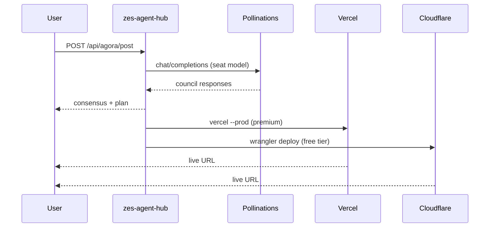

# zes-agent-hub

**Agent orchestration hub for ZES workspaces — named agent seats, council orchestration, multi-provider model routing, and a generation-to-deployment pipeline.**

`zes-agent-hub` sits between your users and the AI + infrastructure stack. It registers
named agent seats on an AgoraHub, routes prompts through a council, calls Pollinations
for text and images, and drives Vercel + Cloudflare deployments.

[](./LICENSE)
[](https://pollinations.ai)
[](https://workers.cloudflare.com)
[](https://nodejs.org)

---

## Table of Contents

- [Overview](#overview)
- [Current Status](#current-status)
- [Seat Configuration](#seat-configuration)
- [Architecture](#architecture)
- [Pipelines](#pipelines)
- [QC Council](#qc-council)
- [HTTP API](#http-api)
- [Quick Start](#quick-start)
- [Environment Variables](#environment-variables)
- [File Structure](#file-structure)
- [Deployment](#deployment)
- [Troubleshooting](#troubleshooting)
- [License](#license)

---

## Overview

The hub is the orchestration layer that:

1. **Routes prompts** through a council of named agent seats (Castor orchestrator plus
   four council members).
2. **Generates text** through the Pollinations API Gateway using per-seat model
   assignments.
3. **Generates images** through the Pollinations Image API.
4. **Plans and runs deployments** of a derived HTML template to Vercel (premium) and
   Cloudflare (free tier).
5. **(Planned)** Schedules recurring auto-blog posts via Cloudflare Cron Triggers + D1 + R2.

Every template, model and deployment target is configurable through
[`seats/config.json`](./seats/config.json) and environment variables — no core
orchestration changes required.

---

## Current Status

The repository is an active reference implementation. What works today:

| Area | State |
| --- | --- |
| `server/index.js` (Express + WebSocket hub) | Working — `GET /healthz` and `/api/agora/*` respond |
| `scripts/deploy-pipeline.js` | Implemented (clone/pull template, `vercel --prod`, `wrangler deploy`) |
| `scripts/council-run.js` | Implemented — requires a valid `POLLINATIONS_API_KEY` |
| `scripts/drive-loop.js` | Implemented — polls seat inboxes on an interval |
| `scripts/setup-seats.js` | Implemented — prints the seat and delegation plan |
| QC Council | Implemented — `server/lib/qc.js`, two vision reviewers, pass at ≥ 60 |
| `index.html` | Static HTML template with `{{TITLE}}`, `{{NICHE}}`, `{{HERO_COPY}}`, `{{HERO_IMAGE_URL}}` placeholders |

The package is ESM (`"type": "module"`). R2 image upload and the Postgres-backed job
store (ZAP v1 Milestone 1) remain roadmap items.

---

## Seat Configuration

The council is composed of one orchestrator and four council seats. Seat definitions
live in [`seats/config.json`](./seats/config.json).

| Seat | Role | Model Assignment | Provider |
| --- | --- | --- | --- |
| `castor` | Orchestrator | `castor@deepseek/deepseek-v4.1-flash` | Pollinations |
| `john` | Council | `john@openai/gpt-6-astra` | Pollinations |
| `siti` | Council | `siti@openai/gpt-6.1-terra` | Pollinations |
| `laurent` | Council | `laurent@x-ai/grok-4.6` | Pollinations |
| `labu` | Council | `labu@deepseek/deepseek-v4.1-flash` | Pollinations |

Model routing works as follows:

- `seat.model` in `seats/config.json` is used first.
- If a seat has no model, `POLLINATIONS_MODEL_ORCHESTRATOR` is the fallback.
- The gateway endpoint comes from `POLLINATIONS_GATEWAY_URL`; the key comes from
  `POLLINATIONS_API_KEY`.

The `POLLINATIONS_MODEL_<SEAT>` variables in `.env.example` mirror the seat table for
reference. They are not read by the current code — change `seats/config.json` to change a
seat's model.

---

## Architecture

### Council orchestration

```mermaid
flowchart TD
    A([User Prompt]) --> B["castor@deepseek/deepseek-v4.1-flash<br/>Orchestrator"]
    B -->|routing plan| C[Council Channel]
    C --> D1[john@openai/gpt-6-astra]
    C --> D2[siti@openai/gpt-6.1-terra]
    C --> D3[laurent@x-ai/grok-4.6]
    C --> D4[labu@deepseek/deepseek-v4.1-flash]
    D1 --> E[Consensus and synthesis]
    D2 --> E
    D3 --> E
    D4 --> E
    E --> F[Pollinations API Gateway]
    F --> G[Build and deploy plan]
    G --> H[Vercel]
    G --> I[Cloudflare]
```

### Request path



---

## Pipelines

### Free tier (template + Cloudflare)

1. Copy the template (`https://zes.codes`) or use the local clone at `ZES_CODES_PATH`.
2. Substitute `{{TITLE}}`, `{{NICHE}}`, `{{HERO_COPY}}` and `{{HERO_IMAGE_URL}}` in
   `index.html`.
3. Deploy with `wrangler deploy` (Cloudflare Workers).
4. Return the live URL to the caller.

### Premium (Vercel + Cloudflare)

`scripts/deploy-pipeline.js` performs three stages: clone/pull the template, deploy to
Vercel with `vercel --prod`, then deploy to Cloudflare with `wrangler deploy`.

### Auto-blog (planned)

Recurring posts via Cloudflare Cron Triggers + D1 + R2 — not implemented yet.

---

## QC Council

The QC Council inspects generated images in parallel: every reviewer receives the image
plus a rubric and answers with `{"score": 0-100, "issues": []}`. The average decides the
verdict — `passed` at 60 or above, `recommendation: "regenerate"` below that.

- Reviewers: the council seat models from `seats/config.json` (falling back to
  `openai/gpt-6-astra` and `x-ai/grok-4.6`).
- A failed verdict triggers a self-healing retry with a new image seed, up to three
  attempts. The free pipeline refuses to deploy after three failures and returns the QC
  report.
- Unavailable checks are reported as `score: null` and never counted as a pass.

---

## ZAP v1 API (`/api/v1`)

The ZESCODE Agent Orchestration Protocol v1 foundation is implemented: PostgreSQL-backed
jobs, tasks, approvals, artifacts, events and audit logs, a validated state machine and a
workflow engine. See [docs/architecture.md](docs/architecture.md) for the assessment.

| Method | Path | Purpose |
| --- | --- | --- |
| POST | `/api/v1/jobs` | Create a job |
| GET | `/api/v1/jobs` | List jobs for an owner (paginated) |
| GET | `/api/v1/jobs/:jobId` | Job detail with tasks |
| GET | `/api/v1/jobs/:jobId/tasks` | List tasks |
| GET | `/api/v1/jobs/:jobId/events` | Event history |
| GET | `/api/v1/jobs/:jobId/artifacts` | Artifacts |
| POST | `/api/v1/jobs/:jobId/transitions` | Request a state transition |
| POST | `/api/v1/jobs/:jobId/cancel` | Cancel a job |
| POST | `/api/v1/jobs/:jobId/resume` | Resume, reclaiming expired leases |
| GET | `/api/v1/tasks/:taskId` | Task detail |
| POST | `/api/v1/tasks/:taskId/transitions` | Request a task transition |
| GET | `/api/v1/agents` | Agent registry with task counts |
| GET | `/api/v1/agents/:agentId` | Agent definition |
| POST | `/api/v1/jobs/:jobId/plan` | Castor creates the task plan |
| POST | `/api/v1/jobs/:jobId/run-next` | Run the next eligible task |
| GET | `/api/v1/jobs/:jobId/usage` | Model usage for the job |
| GET | `/api/v1/approvals` | Pending approvals |
| POST | `/api/v1/approvals/:id/approve` | Approve (single use) |
| POST | `/api/v1/approvals/:id/reject` | Reject (single use) |
| GET | `/api/v1/tools` | Tool registry |
| GET | `/api/v1/tools/executions/:id` | Tool execution status |
| GET | `/api/v1/node-types` | Workflow node registry (`zes.workflow/v1`) |
| POST | `/api/v1/workflows` | Create a workflow definition (draft) |
| GET | `/api/v1/workflows` | List workflow definitions |
| GET | `/api/v1/workflows/:workflowId` | Latest version (or `?version=N`) |
| PUT | `/api/v1/workflows/:workflowId` | Save a new draft version |
| POST | `/api/v1/workflows/:workflowId/publish` | Publish an immutable version |
| GET | `/api/v1/workflows/:workflowId/versions` | Version history |
| POST | `/api/v1/jobs/:jobId/plan` | Plan (definition-driven when a workflow is attached) |
| GET | `/api/v1/jobs/:jobId/graph` | Definition snapshot plus per-node tasks |
| POST | `/api/v1/jobs/:jobId/pause` | Pause a job |

Every `/api/v1` route requires `Authorization: Bearer $AGORA_HUB_ADMIN_KEY` and returns
`401` otherwise. Invalid transitions return `409`.

### Workflow definitions

Create a job from a published definition by passing `workflowId` (and optionally
`workflowVersion`) to `POST /api/v1/jobs`. The job pins the version's `graph_snapshot`,
so publishing a new version never changes a running job. Definitions are validated
server-side: the browser cannot supply model identifiers or permissions, tool nodes are
allowlisted, and a definition may not contain cycles or unknown node types.

Scheduling is dependency-aware (`depends_on`), backs off exponentially via
`next_attempt_at`, reclaims expired leases, and requires verifier evidence before a job
can complete.

Operational endpoints: `GET /health`, `GET /ready` (database + migration check) and
`GET /metrics` (admin key required).

## HTTP API

The Express server (`server/index.js`) listens on `AGORA_HUB_PORT` (default `8765`) and
exposes a WebSocket at `/ws`.

The `/api/agora/*` routes require the admin key: `Authorization: Bearer $AGORA_HUB_ADMIN_KEY`.
They expose seat state and mutating operations, so they are not readable anonymously.

| Method | Path | Purpose |
| --- | --- | --- |
| GET | `/healthz` | Liveness probe |
| GET | `/api/agora/roles` | List roles (admin key required) |
| GET | `/api/agora/seats` | List configured seats |
| GET | `/api/agora/missions` | List seat missions |
| GET | `/api/agora/channels` | List channels |
| GET | `/api/agora/messages` | List channel messages (`?channel=`, `?limit=`) |
| GET | `/api/agora/inbox/:seatId` | Messages for one seat |
| POST | `/api/agora/post` | Post a message |
| POST | `/api/agora/ack` | Acknowledge a message |
| GET | `/api/agora/delegations` | List delegations |
| GET | `/api/agora/drive-status` | Drive-loop status |
| GET | `/api/agora/pipeline-status` | Pipeline configuration |

These routes are currently unauthenticated. `AGORA_HUB_ADMIN_KEY` is declared in
`vercel.json` and `.env.example` but is not enforced by the server yet — do not expose
the hub publicly until auth is added.

### Pipeline API (admin key required)

These routes require `Authorization: Bearer $AGORA_HUB_ADMIN_KEY`. When the key is not
configured the routes fail closed with `503`; a wrong key returns `401`. Request bodies
are validated with zod.

| Method | Path | Body | Response |
| --- | --- | --- | --- |
| POST | `/api/pipeline/free` | `{ title, niche, templateId?, dryRun? }` | `{ ok, liveUrl, provider, imageUrl, qc, previewPath }` |
| POST | `/api/pipeline/premium` | `{ title?, niche?, framework?, deployTarget?, dryRun? }` | `{ ok, liveUrl, provider, previewPath }` |
| POST | `/api/qc/check` | `{ imageUrl, prompt? }` | `{ passed, averageScore, recommendation, models }` |
| POST | `/api/pipeline/council` | `{ prompt }` | `{ ok, routing, responses, synthesis, deployment }` |

`dryRun: true` renders the site and returns the local path without touching Vercel or
Cloudflare.

Free tier flow: hero copy (Castor) → hero image (Pollinations Image API) → QC Council
(two vision models, pass at ≥ 60) → template render → Cloudflare Pages deploy. A failed
QC verdict is retried with a new seed up to three times; the pipeline then returns
`422` with the QC report rather than deploying.

```bash
curl -X POST http://localhost:8765/api/pipeline/free \
  -H "Authorization: Bearer $AGORA_HUB_ADMIN_KEY" \
  -H "Content-Type: application/json" \
  -d '{"title":"Joe Coffee","niche":"coffee shop","dryRun":true}'
```

---

## Quick Start

Requires Node.js 20 or newer.

```bash
git clone https://github.com/ZESCODE/zes-agent-hub.git
cd zes-agent-hub
npm install
cp .env.example .env      # then fill in the required keys
npm run start             # Express hub on http://localhost:8765
```

Check it is alive:

```bash
curl http://localhost:8765/healthz
```

See [Current Status](#current-status) before relying on the council and seat scripts.

---

## Environment Variables

Copy `.env.example` to `.env`. The table below matches that file exactly.

| Variable | Required | Purpose |
| --- | --- | --- |
| `AGORA_HUB_URL` | yes | Public base URL of this hub (used in docs and clients) |
| `AGORA_HUB_ADMIN_KEY` | yes | Admin key for hub API calls (declared, not yet enforced) |
| `AGORA_HUB_DB_PATH` | no | SQLite path for hub state |
| `AGORA_HUB_PORT` | no | HTTP port, default `8765` |
| `DATABASE_URL` | yes* | PostgreSQL connection string for the job store |
| `PGLITE_DATA_DIR` | no | PGlite data directory when `DATABASE_URL` is unset |
| `POLLINATIONS_API_KEY` | yes | Pollinations bearer token |
| `POLLINATIONS_API_BASE` | no | Pollinations API origin |
| `POLLINATIONS_GATEWAY_URL` | no | OpenAI-compatible gateway base, default `https://api.pollinations.ai/v1` |
| `POLLINATIONS_MODEL_ORCHESTRATOR` | no | Fallback model when a seat has none |
| `POLLINATIONS_MODEL_CASTOR` | no | Reference value for the castor seat |
| `POLLINATIONS_MODEL_JOHN` | no | Reference value for the john seat |
| `POLLINATIONS_MODEL_SITI` | no | Reference value for the siti seat |
| `POLLINATIONS_MODEL_LAURENT` | no | Reference value for the laurent seat |
| `POLLINATIONS_MODEL_LABU` | no | Reference value for the labu seat |
| `KILO_API_KEY` | no | Kilo Gateway key for fallback models |
| `KILO_GATEWAY_URL` | no | Kilo Gateway base URL |
| `VERCEL_API_KEY` | yes* | Vercel token for deploys |
| `VERCEL_TEAM_ID` | no | Vercel team scope |
| `VERCEL_PROJECT_ID` | no | Vercel project scope |
| `CLOUDFLARE_API_TOKEN` | yes* | Cloudflare token for deploys |
| `CLOUDFLARE_ACCOUNT_ID` | yes* | Cloudflare account id |
| `CLOUDFLARE_ZONE_ID` | no | Cloudflare zone id for custom domains |
| `PIPELINE_NAME` | no | Pipeline label (`vercel-cloudflare-build-deploy`) |
| `PIPELINE_TEMPLATE` | no | Template URL, default `https://zes.codes` |
| `ZES_CODES_PATH` | no | Local template clone used by the deploy script |
| `SEATS_CONFIG_PATH` | no | Path to seat config, default `./seats/config.json` |
| `DRIVE_LOOP_INTERVAL_MS` | no | Drive-loop poll interval, default `30000` |
| `COUNCIL_CHANNEL_NAME` | no | Council channel name, default `council-channel` |
| `LOG_LEVEL` | no | Log verbosity |
| `LOG_DIR` | no | Log directory |
| `CLOUDFLARE_PAGES_PROJECT` | no | Cloudflare Pages project used by the deploy pipeline |

\* Required only for the corresponding deployment target. `DATABASE_URL` is required for a production job store; without it the Hub uses PGlite (development only).

Never commit `.env`. Only `.env.example` belongs in git.

---

## File Structure

```text
.
├── .env.example
├── Dockerfile
├── EXAMPLES.md
├── LICENSE
├── README.md
├── diagram.txt
├── docker-compose.yaml
├── index.html                  # HTML template with {{PLACEHOLDER}} slots
├── package.json
├── scripts
│   ├── council-run.js          # Orchestrator + council cycle
│   ├── deploy-pipeline.js      # Clone/pull template, Vercel + Cloudflare deploy
│   ├── drive-loop.js           # Unattended seat polling
│   └── setup-seats.js          # Register seats and delegations
├── docs
│   └── architecture.md         # ZAP v1 repository assessment and roadmap
├── migrations
│   └── 001_zap_v1.sql          # ZAP v1 schema
├── seats
│   └── config.json             # Seats, delegations, pipeline config
├── server
│   ├── index.js                # Express + WebSocket AgoraHub server
│   ├── pollinations-client.js  # Pollinations text client
│   └── lib
│       ├── api/v1.js           # ZAP v1 REST API
│       ├── council.js          # Council cycle
│       ├── db/pool.js          # PostgreSQL / PGlite access
│       ├── deploy.js           # Free and premium pipelines
│       ├── images.js           # Image URL + hero copy
│       ├── qc.js               # QC Council
│       ├── repositories/       # Jobs, tasks, events, audit, artifacts
│       └── workflows/          # State machine + engine
├── tests
│   ├── integration/            # Persistence and HTTP API tests
│   └── unit/                   # State machine tests
├── tsconfig.json
├── vercel.json
├── vite.config.ts              # Dev proxy to the hub on :8765
└── wrangler.toml               # Workers Assets config for dist/
```

---

## Deployment

The hub is a long-lived Node process with a WebSocket endpoint, so it needs a host
that keeps a process running. The production deployment is:

| Piece | Where |
| --- | --- |
| Hub | Render service `zes-agent-hub` (free tier, Node 22, region Oregon) |
| Domain | `hub.zes.codes` → CNAME `zes-agent-hub.onrender.com` (Cloudflare DNS, verified by Render) |
| Database | Supabase PostgreSQL (project region `ap-northeast-1`) |
| Entry point | `node scripts/start.js` |

### Local

```bash
npm run dev        # Vite dev server on :5173, proxies /api/agora to :8765
npm run start      # Hub server on :8765
```

### Database

`DATABASE_URL` selects PostgreSQL; without it the hub falls back to PGlite
(PostgreSQL compiled to WASM). PGlite needs roughly 330 MB of RAM and peaks
around 1.5 GB while it initialises, so it does not fit a 512 MB instance. Use
PostgreSQL in production and keep PGlite for development and tests.

```bash
npm run db:migrate
```

Use the **connection pooler** endpoint for hosts without IPv6 egress:

```
postgresql://postgres.<project-ref>:<password>@aws-0-<region>.pooler.supabase.com:5432/postgres
```

The direct host `db.<project-ref>.supabase.co` can be IPv6-only, which fails on
IPv4-only hosts such as Render.

`sslmode=require` is treated as "encrypt without verifying the chain", matching
libpq. Strict modes (`verify-full`, `verify-ca`) are left untouched.

### Docker

```bash
docker compose up -p
```

The compose file expects a `.env` file and mounts `./data` and `./logs`.

### Vercel

```bash
npm run deploy:vercel
```

`vercel.json` routes every `/api/*` path plus `/health`, `/ready` and `/metrics`
to `server/index.js` and serves the SPA from `index.html` for everything else.
A Vercel function cannot hold the WebSocket endpoint, so the Agora council needs
a long-lived host such as Render.

### Cloudflare

```bash
npm run deploy:cloudflare
```

`wrangler.toml` deploys the static build in `dist/` as Workers Assets. The Express hub
is a long-lived Node process, so run it separately (Docker or a Node host) or port the
routes to a Worker before expecting `/api/agora/*` on Cloudflare.

---


## Troubleshooting

**Pollinations returns HTTP 522.**
The gateway default `https://api.pollinations.ai/v1` has been observed returning 522.
Point `POLLINATIONS_GATEWAY_URL` at `https://gen.pollinations.ai/v1`, which serves
`/chat/completions` and `/models`.

**Council run hangs or returns 401.**
`agent:council` and `agent:setup` need a real `POLLINATIONS_API_KEY`; with a dummy
key the first request never completes.

**Server and scripts look out of sync with the docs.**
All `server/*.js` and `scripts/*.js` parse and boot as of this revision; run
`node --check` on a file before assuming a documentation error.

---

## License

MIT — see [LICENSE](./LICENSE).
