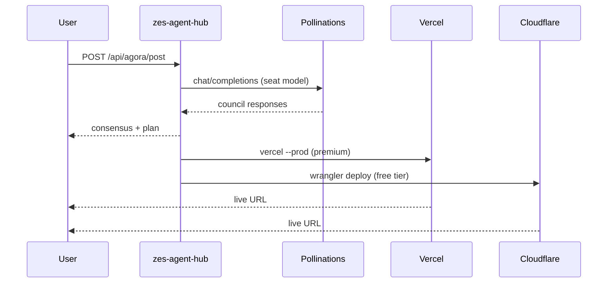

# zes-agent-hub

**Agent orchestration hub for ZES workspaces — named agent seats, council orchestration, multi-provider model routing, and a generation-to-deployment pipeline.**

`zes-agent-hub` sits between your users and the AI + infrastructure stack. It registers
named agent seats on an AgoraHub, routes prompts through a council, calls Pollinations
for text and images, and drives Vercel + Cloudflare deployments.

[](./LICENSE)
[](https://pollinations.ai)
[](https://workers.cloudflare.com)
[](https://nodejs.org)

---

## Table of Contents

- [Overview](#overview)
- [Current Status](#current-status)
- [Seat Configuration](#seat-configuration)
- [Architecture](#architecture)
- [Pipelines](#pipelines)
- [QC Council](#qc-council)
- [HTTP API](#http-api)
- [Quick Start](#quick-start)
- [Environment Variables](#environment-variables)
- [File Structure](#file-structure)
- [Deployment](#deployment)
- [Troubleshooting](#troubleshooting)
- [License](#license)

---

## Overview

The hub is the orchestration layer that:

1. **Routes prompts** through a council of named agent seats (Castor orchestrator plus
   four council members).
2. **Generates text** through the Pollinations API Gateway using per-seat model
   assignments.
3. **Generates images** through the Pollinations Image API.
4. **Plans and runs deployments** of a derived HTML template to Vercel (premium) and
   Cloudflare (free tier).
5. **(Planned)** Schedules recurring auto-blog posts via Cloudflare Cron Triggers + D1 + R2.

Every template, model and deployment target is configurable through
[`seats/config.json`](./seats/config.json) and environment variables — no core
orchestration changes required.

---

## Current Status

The repository is an active reference implementation. What works today:

| Area | State |
| --- | --- |
| `server/index.js` (Express + WebSocket hub) | Working — `GET /healthz` and `/api/agora/*` respond |
| `scripts/deploy-pipeline.js` | Implemented (clone/pull template, `vercel --prod`, `wrangler deploy`) |
| `scripts/council-run.js` | Implemented — requires a valid `POLLINATIONS_API_KEY` |
| `scripts/drive-loop.js` | Implemented — polls seat inboxes on an interval |
| `scripts/setup-seats.js` | Implemented — prints the seat and delegation plan |
| QC Council | Design only — no code in this repository yet |
| `index.html` | Static HTML template with `{{TITLE}}`, `{{NICHE}}`, `{{HERO_COPY}}`, `{{HERO_IMAGE_URL}}` placeholders |

The package is ESM (`"type": "module"`). QC Council and R2 upload remain roadmap items.

---

## Seat Configuration

The council is composed of one orchestrator and four council seats. Seat definitions
live in [`seats/config.json`](./seats/config.json).

| Seat | Role | Model Assignment | Provider |
| --- | --- | --- | --- |
| `castor` | Orchestrator | `castor@deepseek-v4.1-flash` | Pollinations |
| `john` | Council | `john@gpt-6-astra` | Pollinations |
| `siti` | Council | `siti@claude-opus-5.5` | Pollinations |
| `laurent` | Council | `laurent@grok-4.7` | Pollinations |
| `labu` | Council | `labu@deepseek-v4.1-flash` | Pollinations |

Model routing works as follows:

- `seat.model` in `seats/config.json` is used first.
- If a seat has no model, `POLLINATIONS_MODEL_ORCHESTRATOR` is the fallback.
- The gateway endpoint comes from `POLLINATIONS_GATEWAY_URL`; the key comes from
  `POLLINATIONS_API_KEY`.

The `POLLINATIONS_MODEL_<SEAT>` variables in `.env.example` mirror the seat table for
reference. They are not read by the current code — change `seats/config.json` to change a
seat's model.

---

## Architecture

### Council orchestration

```mermaid
flowchart TD
    A([User Prompt]) --> B["castor@deepseek-v4.1-flash<br/>Orchestrator"]
    B -->|routing plan| C[Council Channel]
    C --> D1[john@gpt-6-astra]
    C --> D2[siti@claude-opus-5.5]
    C --> D3[laurent@grok-4.7]
    C --> D4[labu@deepseek-v4.1-flash]
    D1 --> E[Consensus and synthesis]
    D2 --> E
    D3 --> E
    D4 --> E
    E --> F[Pollinations API Gateway]
    F --> G[Build and deploy plan]
    G --> H[Vercel]
    G --> I[Cloudflare]
```

### Request path



---

## Pipelines

### Free tier (template + Cloudflare)

1. Copy the template (`https://zes.codes`) or use the local clone at `ZES_CODES_PATH`.
2. Substitute `{{TITLE}}`, `{{NICHE}}`, `{{HERO_COPY}}` and `{{HERO_IMAGE_URL}}` in
   `index.html`.
3. Deploy with `wrangler deploy` (Cloudflare Workers).
4. Return the live URL to the caller.

### Premium (Vercel + Cloudflare)

`scripts/deploy-pipeline.js` performs three stages: clone/pull the template, deploy to
Vercel with `vercel --prod`, then deploy to Cloudflare with `wrangler deploy`.

### Auto-blog (planned)

Recurring posts via Cloudflare Cron Triggers + D1 + R2 — not implemented yet.

---

## QC Council

The QC Council is the planned parallel image-inspection stage: generated images are
scored by several vision models, and failures trigger a self-healing retry (new seed, up
to three attempts) before a deploy is allowed.

**This is design only.** The current codebase contains no QC implementation, no vision
model calls and no retry loop. Treat every QC claim in older docs as a roadmap item.

---

## HTTP API

The Express server (`server/index.js`) listens on `AGORA_HUB_PORT` (default `8765`) and
exposes a WebSocket at `/ws`.

| Method | Path | Purpose |
| --- | --- | --- |
| GET | `/healthz` | Liveness probe |
| GET | `/api/agora/roles` | List roles |
| GET | `/api/agora/seats` | List configured seats |
| GET | `/api/agora/missions` | List seat missions |
| GET | `/api/agora/channels` | List channels |
| GET | `/api/agora/messages` | List channel messages (`?channel=`, `?limit=`) |
| GET | `/api/agora/inbox/:seatId` | Messages for one seat |
| POST | `/api/agora/post` | Post a message |
| POST | `/api/agora/ack` | Acknowledge a message |
| GET | `/api/agora/delegations` | List delegations |
| GET | `/api/agora/drive-status` | Drive-loop status |
| GET | `/api/agora/pipeline-status` | Pipeline configuration |

These routes are currently unauthenticated. `AGORA_HUB_ADMIN_KEY` is declared in
`vercel.json` and `.env.example` but is not enforced by the server yet — do not expose
the hub publicly until auth is added.

---

## Quick Start

Requires Node.js 20 or newer.

```bash
git clone https://github.com/ZESCODE/zes-agent-hub.git
cd zes-agent-hub
npm install
cp .env.example .env      # then fill in the required keys
npm run start             # Express hub on http://localhost:8765
```

Check it is alive:

```bash
curl http://localhost:8765/healthz
```

See [Current Status](#current-status) before relying on the council and seat scripts.

---

## Environment Variables

Copy `.env.example` to `.env`. The table below matches that file exactly.

| Variable | Required | Purpose |
| --- | --- | --- |
| `AGORA_HUB_URL` | yes | Public base URL of this hub (used in docs and clients) |
| `AGORA_HUB_ADMIN_KEY` | yes | Admin key for hub API calls (declared, not yet enforced) |
| `AGORA_HUB_DB_PATH` | no | SQLite path for hub state |
| `AGORA_HUB_PORT` | no | HTTP port, default `8765` |
| `POLLINATIONS_API_KEY` | yes | Pollinations bearer token |
| `POLLINATIONS_API_BASE` | no | Pollinations API origin |
| `POLLINATIONS_GATEWAY_URL` | no | OpenAI-compatible gateway base, default `https://api.pollinations.ai/v1` |
| `POLLINATIONS_MODEL_ORCHESTRATOR` | no | Fallback model when a seat has none |
| `POLLINATIONS_MODEL_CASTOR` | no | Reference value for the castor seat |
| `POLLINATIONS_MODEL_JOHN` | no | Reference value for the john seat |
| `POLLINATIONS_MODEL_SITI` | no | Reference value for the siti seat |
| `POLLINATIONS_MODEL_LAURENT` | no | Reference value for the laurent seat |
| `POLLINATIONS_MODEL_LABU` | no | Reference value for the labu seat |
| `KILO_API_KEY` | no | Kilo Gateway key for fallback models |
| `KILO_GATEWAY_URL` | no | Kilo Gateway base URL |
| `VERCEL_API_KEY` | yes* | Vercel token for deploys |
| `VERCEL_TEAM_ID` | no | Vercel team scope |
| `VERCEL_PROJECT_ID` | no | Vercel project scope |
| `CLOUDFLARE_API_TOKEN` | yes* | Cloudflare token for deploys |
| `CLOUDFLARE_ACCOUNT_ID` | yes* | Cloudflare account id |
| `CLOUDFLARE_ZONE_ID` | no | Cloudflare zone id for custom domains |
| `PIPELINE_NAME` | no | Pipeline label (`vercel-cloudflare-build-deploy`) |
| `PIPELINE_TEMPLATE` | no | Template URL, default `https://zes.codes` |
| `ZES_CODES_PATH` | no | Local template clone used by the deploy script |
| `SEATS_CONFIG_PATH` | no | Path to seat config, default `./seats/config.json` |
| `DRIVE_LOOP_INTERVAL_MS` | no | Drive-loop poll interval, default `30000` |
| `COUNCIL_CHANNEL_NAME` | no | Council channel name, default `council-channel` |
| `LOG_LEVEL` | no | Log verbosity |
| `LOG_DIR` | no | Log directory |

\* Required only for the corresponding deployment target.

Never commit `.env`. Only `.env.example` belongs in git.

---

## File Structure

```text
.
├── .env.example
├── Dockerfile
├── EXAMPLES.md
├── LICENSE
├── README.md
├── diagram.txt
├── docker-compose.yaml
├── index.html                  # HTML template with {{PLACEHOLDER}} slots
├── package.json
├── scripts
│   ├── council-run.js          # Orchestrator + council cycle
│   ├── deploy-pipeline.js      # Clone/pull template, Vercel + Cloudflare deploy
│   ├── drive-loop.js           # Unattended seat polling
│   └── setup-seats.js          # Register seats and delegations
├── seats
│   └── config.json             # Seats, delegations, pipeline config
├── server
│   ├── index.js                # Express + WebSocket AgoraHub server
│   └── pollinations-client.js  # Pollinations text client
├── tsconfig.json
├── vercel.json
├── vite.config.ts              # Dev proxy to the hub on :8765
└── wrangler.toml               # Workers Assets config for dist/
```

---

## Deployment

### Local

```bash
npm run dev        # Vite dev server on :5173, proxies /api/agora to :8765
npm run start      # Hub server on :8765
```

### Docker

```bash
docker compose up -d
```

The compose file expects a `.env` file and mounts `./data` and `./logs`.

### Vercel

```bash
npm run deploy:vercel
```

`vercel.json` currently points at `agent-hub/server/index.js`, which does not match this
repository layout. Update the route destinations to `server/index.js` before deploying,
or run the hub as a long-lived Node process (Docker) instead.

### Cloudflare

```bash
npm run deploy:cloudflare
```

`wrangler.toml` deploys the static build in `dist/` as Workers Assets. The Express hub
is a long-lived Node process, so run it separately (Docker or a Node host) or port the
routes to a Worker before expecting `/api/agora/*` on Cloudflare.

---

## Troubleshooting

**Pollinations returns HTTP 522.**
The gateway default `https://api.pollinations.ai/v1` has been observed returning 522.
Point `POLLINATIONS_GATEWAY_URL` at `https://gen.pollinations.ai/v1`, which serves
`/chat/completions` and `/models`.

**Council run hangs or returns 401.**
`agent:council` and `agent:setup` need a real `POLLINATIONS_API_KEY`; with a dummy
key the first request never completes.

**Server and scripts look out of sync with the docs.**
All `server/*.js` and `scripts/*.js` parse and boot as of this revision; run
`node --check` on a file before assuming a documentation error.

---

## License

MIT — see [LICENSE](./LICENSE).
